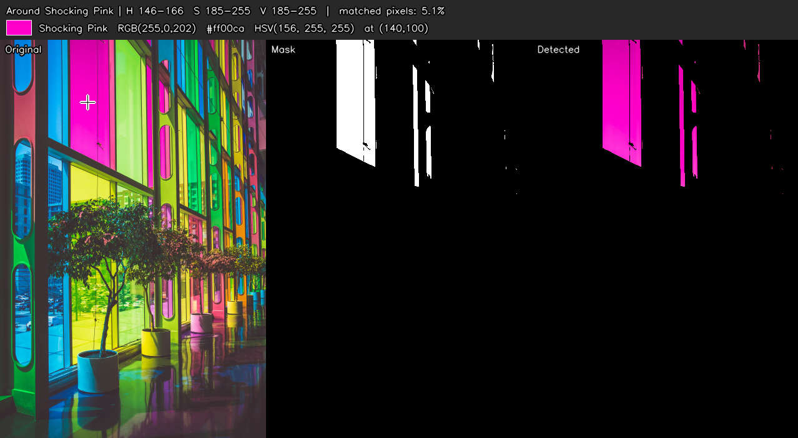
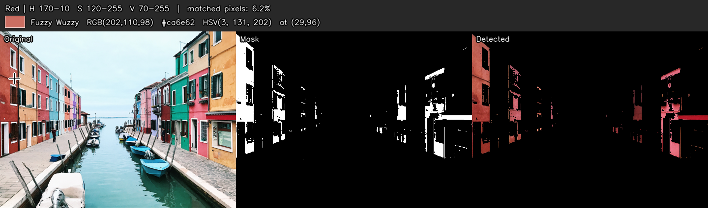
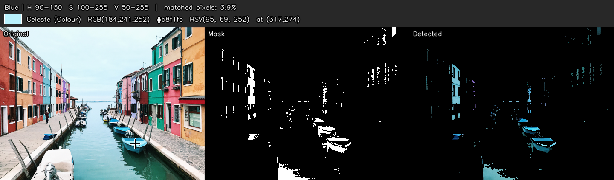
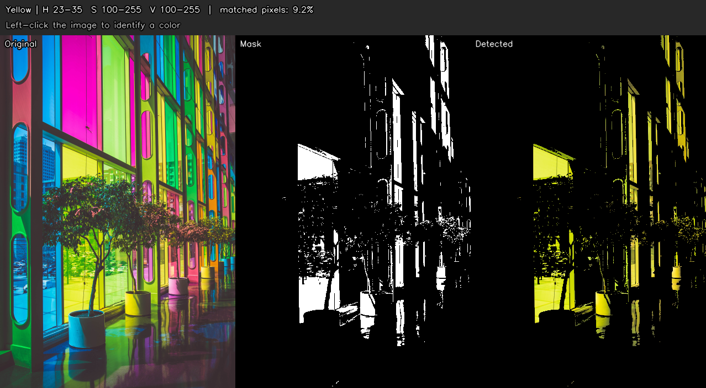
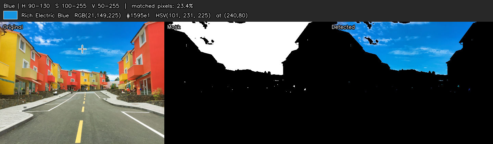
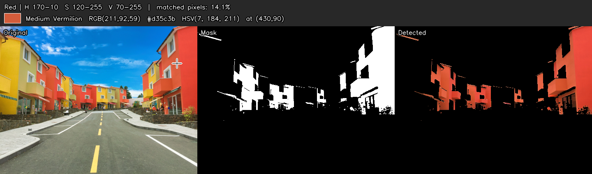

# 🎨 Color Detection Project

An interactive Python app that **identifies colors in an image**. Click any pixel to get its
color name, RGB, HEX and HSV values, or use **HSV trackbars** to isolate every pixel of a
chosen color (for example, all the red houses in a photo).

Built with **Python, OpenCV and NumPy**.

| | |
|---|---|
| **Difficulty** | Beginner |
| **Concepts** | RGB & HSV color spaces, pixel operations, masking, mouse callbacks, trackbars |
| **Libraries** | `opencv-python`, `numpy` |

---

## ✨ Features

- **Click-to-identify** – left-click a pixel to see its nearest color name (from 865 named colors), RGB, HEX and HSV.
- **HSV trackbars** – six sliders (H min/max, S min/max, V min/max) produce a live **mask** and a **detected** view.
- **Red wrap-around support** – red sits at both ends of the hue scale (0 and 179); the app handles this automatically.
- **Right-click helper** – right-click a pixel and the sliders jump to a range around that color.
- **Presets** – keys `1`–`6` select red, orange, yellow, green, blue, purple.
- **Screenshot key** – press `s` to save what you see.
- **Headless mode** – generate result images from the command line, with no window.

## 📁 Project structure

```
Color-Detection/
├── color_detect.py      # main program
├── colors.csv           # 865 named colors (name, hex, R, G, B)
├── requirements.txt     # dependencies
├── images/              # sample images (pic1.jpg, pic2.jpg, pic3.jpg, colorpic.jpg)
├── screenshots/         # demo output
└── README.md
```

## 🛠️ Setup

1. Install **Python 3.8+** (check with `python --version`).
2. Open a terminal in the project folder.
3. *(Recommended)* create a virtual environment:
   ```bash
   python -m venv venv
   venv\Scripts\activate        # Windows
   source venv/bin/activate     # macOS / Linux
   ```
4. Install the dependencies:
   ```bash
   pip install -r requirements.txt
   ```
   (or `pip install opencv-python numpy`)

## ▶️ Usage

```bash
python color_detect.py --image images/pic1.jpg
```

Two windows open: **Color Detection** (images) and **HSV Controls** (sliders).

### Controls

| Input | Action |
|---|---|
| Left click on the image | Identify the color under the cursor |
| Right click on the image | Set the sliders around the clicked color |
| Sliders | Tune the HSV range; the mask updates live |
| `1` `2` `3` `4` `5` `6` | Presets: red, orange, yellow, green, blue, purple |
| `0` or `r` | Reset sliders to the full range |
| `s` | Save a screenshot to `screenshots/` |
| `q` or `Esc` | Quit |

### Command-line options

| Option | Description |
|---|---|
| `--image PATH` | Input image (**required**) |
| `--csv PATH` | Color-name table (default: `colors.csv`) |
| `--headless` | Don't open a window; save the result to `--output` |
| `--preset NAME` | (headless) `red`, `orange`, `yellow`, `green`, `blue`, `purple` |
| `--point X,Y` | (headless) identify the pixel at X,Y of the displayed image |
| `--output PATH` | (headless) output file, default `screenshots/result.png` |
| `--screenshot-dir DIR` | Folder used by the `s` key |

Headless example:

```bash
python color_detect.py --image images/pic3.jpg --preset red --point 29,96 --headless --output screenshots/02_red_houses.png
```

## 🔍 How it works

1. **Load & resize** – the image is read with `cv2.imread` and shrunk to fit the screen.
2. **Color naming** – `colors.csv` is loaded into a NumPy array. For a clicked pixel, the program computes the
   distance to all 865 colors in one vectorised step and returns the closest name.
3. **BGR → HSV** – `cv2.cvtColor` converts the image to HSV. HSV is better than RGB for color detection because
   *Hue* (the color itself) is separated from *Saturation* (how vivid) and *Value* (how bright).
   OpenCV ranges: **H 0–179, S 0–255, V 0–255**.
4. **Masking** – `cv2.inRange` makes a black/white mask (white = pixel inside the range).
   `cv2.bitwise_and` keeps only those pixels from the original image.
5. **Red wrap-around** – if `H min > H max` (e.g. 170 → 10) the mask is built from two ranges and combined with `bitwise_or`.
6. **UI** – trackbars (`cv2.createTrackbar`) and a mouse callback (`cv2.setMouseCallback`) make it interactive.

## 📸 Screenshots

**1. Click to identify a color** – clicking the pink glass reports *Shocking Pink*, `#ff00ca`, with all matching pixels shown.


**2. Red preset** – red houses are detected (hue wraps around 0).


**3. Blue preset** – boats and water.


**4. Yellow preset** – yellow panels in the glass wall.


**5. Sky blue** – 23% of the image is blue sky.


**6. Red/orange buildings** – clicked pixel identified as *Medium Vermilion*.


## ⚠️ Troubleshooting

| Problem | Fix |
|---|---|
| `could not read image` | Check the `--image` path; use quotes if it has spaces. |
| `No module named cv2` | Run `pip install opencv-python`. |
| Window doesn't open on a server / WSL | Use `--headless`. |
| Wrong color detected | Colors depend on lighting. Widen the S/V sliders or right-click the color to auto-set the range. |
| Color name looks odd | The name is the *closest* of 865 known colors, so it's an approximation. |

## 🚀 Ideas for improvement

- Use your webcam (`cv2.VideoCapture(0)`) for live detection.
- Draw bounding boxes around detected regions with `cv2.findContours`.
- Save/load custom HSV presets to a JSON file.

## 📚 Credits

Based on the open-source *Color Detection* project. Color names from `colors.csv`. Sample photos were included with the original project.
